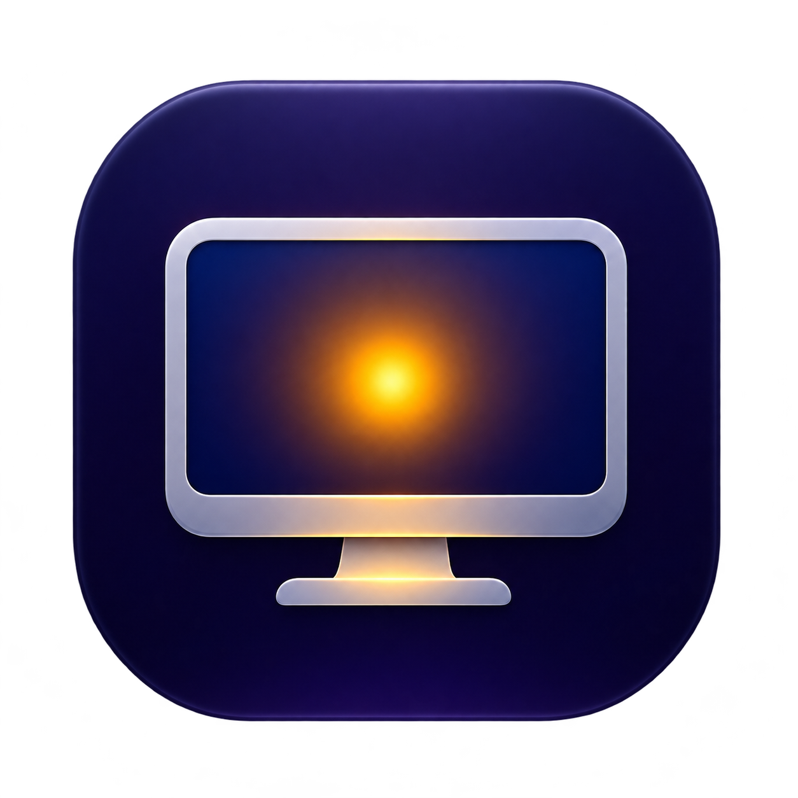

# WakeLight



Mac mini が Wake on LAN で一時復帰したときに画面を点けるバックグラウンドアプリです。電源ログの `Enet.MagicPacket` による `DarkWake` を検知した場合だけ、画面点灯を30秒間要求します。

## インストール

macOS 13 以降と Swift 6 が必要です。

```sh
./scripts/install.sh
```

アプリをビルドし、管理者権限で `/Applications/WakeLight.app` に配置します。旧版の自動起動サービスが動作していれば停止し、LaunchDaemon を新しいアプリに切り替えてその場で起動します。次回からは macOS 起動時にログインを待たずに開始します。更新も同じコマンドで行えます。

## 動作確認

```sh
launchctl print system/com.indivisual.WOLFullWake
log stream --level info --predicate 'subsystem == "com.indivisual.WOLFullWake"'
```

Mac をスリープさせてからスマホで Magic Packet を送り、画面が点くことを確認します。ログの `requested display wake` は画面点灯コマンドを起動したことを示します。

## 停止・削除

```sh
sudo launchctl bootout system/com.indivisual.WOLFullWake
sudo rm /Library/LaunchDaemons/com.indivisual.WOLFullWake.plist
sudo rm -r /Applications/WakeLight.app
```

旧版から更新した場合は、不要になった `/Library/PrivilegedHelperTools/com.indivisual.WOLFullWake` も削除できます。

## ビルドのみ

```sh
./scripts/build-app.sh
```

成果物は `dist/WakeLight.app` です。単体では起動したセッションで監視します。インストール済みのサービスと重複して起動する必要はありません。
